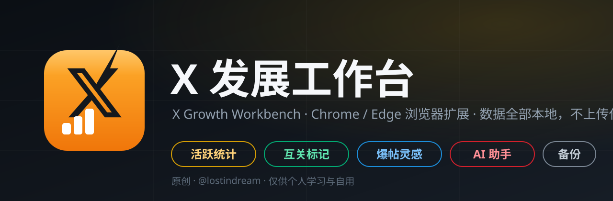

# X 发展工作台（浏览器扩展）

<div align="center">
  
</div>

> **版权说明**：本扩展由 **@lostindream**（X：[@lostindream](https://x.com/lostindream)）原创开发。
> 仅供个人学习与自用，禁止未经授权的商业用途、二次打包分发或去除版权声明。

在 X（Twitter）网页版上把「看数据、认关系、写内容、存媒体」四件事装进一个扩展：时间线活跃度统计、互关标记、AI 回复草稿、爆帖灵感、媒体备份与导出，全部本地运行、数据不上传。

**当前版本 v1.9.4** · Manifest V3 · Chromium 111+ · 零依赖、零构建，加载即用

## 功能总览

| 模块 | 内容 |
|---|---|
| 时间线统计 | 作者名旁徽章 `发 N 评 M`（可选加「转」「粉」）；「今日活跃」悬浮面板，按活跃度排行，自己置顶 |
| 互关标记 | `互关 / 未回关 / 关注我 / 无关注` 四色标记 + 自己的推文金色「本尊」标，位置与配色可自定义 |
| 时间线增强 | 流速勋章 `🔥N/h`、账号备注、改名记录、广告过滤 |
| AI 助手 | 回复草稿（8 种语气，你审核后自己发送）、换一个（防雷同重生成）、一键发布、仿写、翻译、校对排版、推文海报 |
| 爆帖灵感 | 发帖窗口点 AI → 结合时间线热点出 5 条选题（方向 + 钩子句）→ 一键扩写成完整草稿填入发帖框；已写内容可「文案优化」（诊断 + 优化版 + 两个备选，一键替换） |
| 媒体备份 | 单推一键备份原图/最高码率视频；批量收集与筛选下载、zip 分卷、推文数据 CSV 导出 |

- 每条推文作者名旁有一个小徽章：`发 N 评 M`（灰色 `发– 评–` 表示今天还没在时间线捕获到该用户的内容）
- 「今日活跃」面板默认在右上，设置页顶部有常驻快捷开关可一键关闭
- 完整设置页：扩展管理页 → 「详细信息」→「扩展选项」（或点面板底部的「设置」）

## 安装（Edge / Chrome 通用，需要 Chromium 111+）

1. 打开扩展管理页：
   - Edge 地址栏输入 `edge://extensions`
   - Chrome 地址栏输入 `chrome://extensions`
2. 打开左下角（Chrome 为右上角）的**开发人员模式 / 开发者模式**开关
3. 点击**加载解压缩的扩展**，选择本目录 `x-activity-meter`
4. 打开或刷新 `x.com`，开始滚动时间线即可

## 设置页（v1.5.0 起，v1.6.0 改为工作台风格）

面板底栏点「设置」或扩展管理页 → 详细信息 → 扩展选项打开。左侧分组导航 + 右侧分组卡片（一次展开一个，BlueV 同款交互），所有设置即时保存、仅存本机，修改后无需刷新 x.com 立即生效：

| 分组 | 可自定义项 |
|---|---|
| 时间线统计 | 徽章开/关与「评/转/粉」列；面板开/关、位置、宽度、主题、条数、排序；互关标记（五种关系独立开关与配色、位置、已识别计数） |
| 时间线增强 | 流速勋章；账号备注（增删改、颜色标签）；改名记录标记；广告过滤；媒体收集与批量下载 |
| 统计与同步 | 手动指定本人账号；自动补全开/关、启动间隔、并行数、冷却、单会话上限 |
| AI 助手 | 接口地址 / API Key / 模型名 / 说话风格备注 / 测试连接 |
| 数据 | 导出 / 导入 JSON（含备注）、清空今日统计 |
| 关于 | 工作原理、权限说明、排查、调试日志 |

## 时间线增强（v1.6.0 起，借鉴 BlueV / XHunt / 媒体下载器）

- **流速勋章**：推文右上角 `🔥N/h` = 发布以来平均每小时浏览量（≥1k 红、≥100 橙、其余灰），一眼看出正在升温的推文。数据来自页面自己的响应（`views.count`），零额外请求
- **账号备注**：设置页给任意账号加备注 + 颜色标签，时间线名字旁显示 `📝 备注`，悬停看全文
- **改名记录**（借鉴 XHunt）：检测到账号改显示名时，标出 `曾名 xxx`（悬停看全部曾用名，本地保留 5 条），纯本地追踪
- **广告过滤**（BlueV 同款，默认关）：隐藏带 X 官方推广标记的推文，误伤时关闭即还原
- **媒体收集与批量下载**（借鉴 X Content Backup Tool）：刷时间线时自动记录图片原图（`name=orig`）与视频最高码率 mp4 地址（上限 400 条），设置页缩略图勾选、逐个下载、带进度
- **AI 工具**（复用已配的 AI 接口）：AI 菜单新增「✍️ 仿写此推」（模仿该推文写法生成你的草稿）、「🌐 翻译此推」（弹卡显示可复制）、「🧹 校对排版」（对草稿框文字断句分段，确认后替换）、「🖼 生成海报」（本地 canvas 把推文渲染成图片保存，无需 AI Key）

## 互关标记（v1.5.0 起）

在时间线上标注你与每位作者的关注关系，样式参照同类扩展：`互关`（绿）`未回关`（红）`关注我`（橙）`无关注`（灰），每种关系的显示与颜色均可自定义，位置可选**头像上方**或**名字后面**。自己的推文不参与关系判定，显示金色 `本尊` 标（v1.9.1 起，颜色可改）。

- 数据同样来自页面已加载的响应（`following` / `followed_by` 字段），零额外请求、不上传任何信息
- **任一侧关系未知时不标记**（宁缺勿错）——时间线多数用户只会带「我是否关注了 TA」，所以多数人不会显示标记；点行同步 / 打开过其主页后字段更全
- 设置页显示已识别计数（互关 N · 未回关 N · 关注我 N · 无关注 N）

## 自动补全（v1.3.0 起，v1.4.0 提速为 3 路并行）

面板底部新增「自动补全」开关（默认开）：

- 对**视口内、今天有动静**的用户，后台补拉其主页第一页（约 20 条），**同时最多 3 个页签并行**、启动间隔 5 秒、15 分钟 TTL、单会话上限 60 次——比串行版快约 6 倍
- 自动补全取的是第一页，适合大多数用户；某人今天发了很多条时，**点该行**做前台全量同步（自动翻到今天边界）
- 设计上刻意**不直接调用 X 内部 GraphQL**：那需要动态维护 queryId、伪造 `x-client-transaction-id`（混淆 JS 动态生成），易 404 也易触发风控；打开真实页面复用 X 自己的请求则天然免疫这些
- 所有同步页的数据统一经后台服务**串行合并**入库，多页签并行也不会互相覆盖

## 爆帖灵感（v1.9.0 起）

主页顶部「有什么新鲜事？」发帖窗口的工具栏同样有「AI」按钮，但它不写回复——它帮你**找选题**：

1. 点击选择方向：🔥 热点借势（抓当前时间线可见推文作话题参考）/ 💎 干货清单 / 🙋 提问互动 / 💡 观点金句 / 📖 真诚分享
2. AI 输出 5 条选题，每条含「方向 + 可直接用的钩子句」，右下角弹卡展示
3. 看中哪条点它的 **✍️ 草稿**：AI 把选题扩写成 280 字内的完整推文，自动填入发帖框
4. **你自己审核并点击发布**——扩展绝不代发

已在发帖框打了字？选题会顺着你的方向出。发帖框与回复框的 AI 按钮自动区分场景（回复框出回复菜单，发帖框出灵感菜单）。

### 文案优化（v1.9.5 起）

菜单第一组「文案打磨 → ✨ 文案优化」：针对你**已经写好**的发帖草稿，AI 给出——

- **诊断**：2~3 条要点直接指出问题（钩子、结构、口语感、长度）
- **优化版**：保留原意改写成更抓人的版本（推荐）
- **备选 A / 备选 B**：分别换切入角度、换风格

每个版本都带「填入发帖框」按钮（填入即替换原内容，仍由你审核后发布）。与「校对排版」的区别：校对只纠错别字和排版，不动写法；文案优化会重写。

## AI 草稿回复（v1.4.0 起）

推文详情页/回复弹窗的工具栏会出现「AI」按钮：

1. 点击选择风格：智能匹配 / 赞同共鸣 / 补充观点 / 友好提问 / 专业分析 / 幽默轻松 / 礼貌反驳 / 简短支持
2. 扩展读取被回复的推文内容，按所选风格起草一条 1~3 句的中文回复，**自动填入回复框**
3. **你自己审核并点击发送**——扩展绝不代发

配置（首次点击会引导，4 步）：接口地址、API Key、模型名、个人风格备注。全部只存浏览器本地，密钥仅用于向该接口发请求。

### DeepSeek 配置要点（v1.4.1 已核对官方文档）

| 项 | 值 |
|---|---|
| 接口地址 | `https://api.deepseek.com` |
| 模型名 | `deepseek-flash`（便宜快）或 `deepseek-v4-pro`（更强更贵） |
| Key 获取 | platform.deepseek.com → API keys → 创建 |

- **模型名注意**：`deepseek-chat` / `deepseek-reasoner` 已于 2026-07-24 停用。填旧名会报模型不存在；扩展会尝试自动降级到 `deepseek-flash`，设置保存后也会校验 Key 并自动校准模型名
- **思考模式已关闭**：DeepSeek-V4 默认开启思考模式，思维链会吃掉输出预算导致回复为空，扩展在请求里显式传 `thinking:{type:"disabled"}`
- 计费：按 token 计费，需先充值（个人轻度用充 10–50 元可用很久）；高峰时段为北京时间工作日 9:00–12:00、14:00–18:00，其余时段半价


## 按需同步（v1.2.1）

时间线只会刷到别人的原创贴，别人的评论基本不出现——所以「评 0」不代表他没评论。要真实数据，**点击面板里任意一行**：

- 扩展在**前台**打开该用户主页的「帖子+回复」标签，自动滚动翻页直到翻过今天边界（最末一条早于今天 0 点），然后自动关闭（约 5–40 秒，取决于该用户今天的量）
- 为什么必须前台：Chrome 会节流后台标签页（不渲染、观察器不触发），X 的无限滚动永远不加载第二页——v1.2.0 及之前「只统计到第一页约 20 条」的根因就在这里
- 为什么不用 X 搜索 `from:用户 since:今天`：与 Analytics 同口径没错，但 X 搜索有质量过滤，会漏掉部分回复；主页「帖子+回复」是完整的时间序列
- 同步结束后 toast 会显示「页面今日共 M 条」审计值：**新增 N 条 ≪ M** 说明抓取有漏（发我即可）；**M 本身就少**说明该内容没被页面渲染
- 正在同步时再点其他行会提示排队；一次只同步一人

> 时区提示：官方 Analytics 按 UTC 日切（北京时间早 8 点），本扩展按你本地日期切，0–8 点发布的内容归属会差一天，属口径差异。

## 粉丝数

面板新增「粉丝」列，显示每位用户的**精确**粉丝数（千分位分隔），来源是 X 推文/用户响应里自带的 `followers_count`，同样零额外请求。悬停行可看完整数字。

## 统计口径（重要）

- **只统计你在时间线上刷到的内容**，不会向 X 发送任何额外请求，不存在触发频率限制或风控的风险
- 含义是「他今天在你时间线里出现了几条」，**不是**「他今天全站一共发了几条」——后者需要对每位作者额外请求其主页，本扩展刻意不做
- 按推文 ID 去重：来回滚动、重复加载不会重复计数
- 按推文发布时间的**本地日期**归入「今天」：跨天后自动清零重新统计
- 因此：必须**刷新页面后从头刷**，统计才完整；扩展装好之前已经刷过的内容不计入

## 数据与隐私

- 全部数据保存在浏览器本地（`chrome.storage.local`），不上传、不联网
- 四列数据：粉丝（精确数）/ 发（原创）/ 评（回复）/ 转（转推）；徽章只显示发、评两项
- 多个 X 标签页同时刷会自动合并（按推文 ID 取并集）
- 想清零：面板底部「清空今日」

## 技术实现

- `src/inject.js`（页面上下文，document_start 注入）：劫持 `fetch` / `XMLHttpRequest`，通配所有 `/graphql/` 响应，按「响应体含 `full_text`」判定推文数据并抽取作者、时间与类型；同时抽取用户对象里的 `followers_count`（粉丝数）。不依赖 operation 名、queryId 与 class 名
- `src/content.js`（隔离世界）：按推文 ID 唯一去重（接口通道判定优先于 DOM 兜底）、徽章渲染（MutationObserver + 虚拟列表复用节点时的归属复核）、Shadow DOM 面板（自动跟随 X 的明暗主题）与内置「诊断」区
- 图标：`tools/make_icons.py` 纯标准库渲染——琥珀橙渐变底 + X 官方字形（近黑）+ 三根递增白柱（活跃度），超采样抗锯齿；配图脚本 `tools/make_social_preview.py`（PIL）
- DOM 兜底：读取已渲染推文的 `time[datetime]`，接口通道失效时仍可工作；回复识别基于「正在回复 / Replying to / 返信」等文案，精度略低
- 判断本人账号：读取左侧导航个人主页链接（`AppTabBar_Profile_Link`）

## 面板「诊断」区怎么看

| 显示 | 含义 |
|---|---|
| 接口通道正常（命中 N 批） | 主通道工作，数据最准 |
| 接口通道未命中 · 正在用 DOM 兜底 | 主通道失效（多半是 X 改版），数据会偏少、回复可能误判，把截图发我即可 |

## 排查

- 控制台（F12）过滤 `[XAM]`：默认静默；在 x.com 控制台执行 `localStorage.setItem('xam:debug','1')` 后刷新可开启调试日志
- 面板一直为空且徽章全灰：说明接口截取和 DOM 兜底都没生效，多半是 X 改版，把控制台报错发我即可
- 改了代码后：扩展管理页点刷新按钮，再刷新 x.com

## 文件结构

```
x-activity-meter/
├── manifest.json            # MV3 清单
├── src/inject.js            # 页面上下文：截获时间线响应
├── src/content.js           # 隔离世界：计数 / 徽章 / 面板 / AI / 爆帖灵感
├── src/backup.js            # 媒体备份：单推下载 / 批量面板 / zip 分卷
├── src/options.html|css|js  # 设置页（工作台风格）
├── src/popup.html|css|js    # 快捷弹窗
├── src/settings.js          # 设置读写与归一化
├── src/background.js        # Service Worker：AI 代理 / 下载 / zip
├── assets/banner.svg        # README 横幅
├── assets/social-preview.png# 社交预览图（1280x640）
├── icons/                   # 16 / 48 / 128 图标
└── tools/                   # 图标与配图生成脚本
```
